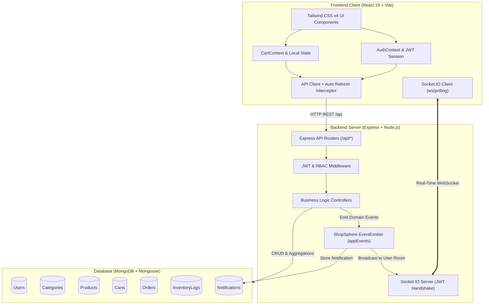

<div align="center">

# 🛍️ ShopSphere

### *Next-Gen Multi-Role E-Commerce & Real-Time Inventory Intelligence Platform*

[](https://react.dev/)
[](https://vitejs.dev/)
[](https://nodejs.org/)
[](https://expressjs.com/)
[](https://www.mongodb.com/)
[](https://socket.io/)
[](https://tailwindcss.com/)
[](LICENSE)

<p align="center">
  <a href="#-key-features"><b>Key Features</b></a> •
  <a href="#-system-architecture"><b>Architecture</b></a> •
  <a href="#-tech-stack"><b>Tech Stack</b></a> •
  <a href="#-getting-started"><b>Getting Started</b></a> •
  <a href="#-test-credentials"><b>Demo Credentials</b></a> •
  <a href="#-api-reference"><b>API Reference</b></a> •
  <a href="#-folder-structure"><b>Folder Structure</b></a>
</p>

---

</div>

## 📖 Overview

**ShopSphere** is an enterprise-grade full-stack **E-Commerce and Inventory Management Platform**. Designed with modern micro-architectural principles, it bridges a responsive, high-performance **React 19 + Vite** client with a rock-solid **Node.js, Express, MongoDB Community Server, and Mongoose** backend.

ShopSphere delivers seamless multi-vendor commerce with distinct, guarded experiences for **Customers**, **Sellers**, and **Store Administrators**, empowered by **JWT role authentication**, **real-time bi-directional WebSockets (Socket.IO)**, and **atomic inventory management**.

---

## ✨ Key Features

### 🔐 1. Enterprise Multi-Role Authentication & RBAC
- **Strict Role Boundaries**: Three discrete operational tiers: `customer`, `seller`, and `admin`.
- **Public Registration Safeguards**: Public onboarding is allowed for `customer` and `seller`; administrative self-registration is strictly forbidden at API middleware.
- **Dual JWT Token Lifecycle**: Short-lived 15-minute Access Tokens paired with secure 7-day Refresh Tokens for frictionless session renewal.
- **Automatic Client Token Refresher**: Built-in HTTP client interceptor seamlessly catches `401` errors, refreshes tokens behind the scenes, and replays failed requests transparently.

### 📦 2. Resilient Inventory & Atomic Checkout
- **Atomic Stock Deductions**: Deducts inventory during checkout using atomic MongoDB operations to prevent race conditions and overselling.
- **Fail-Safe Transaction Rollback**: Attempts replica-set multi-document ACID transactions first; seamlessly falls back to atomic conditional update with compensating rollback on standalone MongoDB instances.
- **Immutable Inventory Audit Log (`InventoryLog`)**: Full traceability for every stock fluctuation (`order_placed`, `order_cancelled`, `restock`, `manual_adjustment`).
- **Low-Stock Triggers**: Instant alerts when stock levels fall beneath designated seller thresholds (`stock <= lowStockThreshold`).

### ⚡ 3. Real-Time Socket.IO Synchronization
- **Private Authenticated Rooms**: Socket handshakes are cryptographically verified via JWT, dynamically assigning users into private isolation rooms (`user:<userId>`).
- **Decoupled Node.js `EventEmitter` Engine**: Controllers emit domain events (`order-placed`, `order-status-updated`, `stock-low`), triggering persistent database notifications while instantly broadcasting live WebSocket updates to customer and seller terminals.
- **Live Notification Center**: Instant UI badges and dropdown feeds without polling.

### 🛍️ 3. Frictionless Shopping Experience
- **Real-Time Product Discovery**: Instant multi-attribute search, category filtering, price sliders, stock availability toggles, and multi-field sorting.
- **Server-Authoritative Persistent Cart**: Shopping carts are securely persisted in MongoDB with prices and totals strictly recomputed on the backend to prevent client-side price tampering.
- **Complete Order Lifecycle**: Track states from `pending` ➔ `confirmed` ➔ `shipped` ➔ `delivered` (or `cancelled` with automatic stock restoration and refunds).

### 📊 4. Deep Seller & Admin Analytics
- **Seller Merchant Portal**: Manage product catalogs, set custom low-stock warning limits, execute stock rebalances, and fulfill customer orders.
- **Live Sales Aggregations**: Native MongoDB aggregation pipelines computing total revenue, average order value, daily sales volume, and top-selling products.
- **Storewide Admin Command**: Global category lifecycle controls, system-wide order supervision, and storewide health monitoring.

---

## 🏗️ System Architecture



---

## 💻 Tech Stack

| Domain | Technology | Description |
| :--- | :--- | :--- |
| **Frontend Framework** | **React 19** | Modern declarative UI library using latest Hooks & Concurrent Mode |
| **Build Tooling** | **Vite 8** | Next-generation ultra-fast frontend build engine & HMR server |
| **Styling** | **Tailwind CSS v4** | Cutting-edge utility-first CSS framework with native CSS engine |
| **Routing** | **React Router DOM v7** | Declarative client-side routing with protected role gates |
| **Backend Runtime** | **Node.js (CommonJS)** | Asynchronous event-driven JavaScript server environment |
| **Web Framework** | **Express.js v4** | Lightweight, modular REST API microframework |
| **Database** | **MongoDB Community Server** | High-performance document database with flexible schema indexing |
| **ODM Modeling** | **Mongoose v8** | Strict schema validation, population, and aggregation pipelines |
| **Authentication** | **JWT & Bcrypt** | Industry-standard password salting & stateless Bearer access/refresh tokens |
| **Real-Time Layer** | **Socket.IO v4** | Low-latency bi-directional event communication over WebSockets |

---

## 📁 Folder Structure

```text
ShopSphere/
├── backend/
│   ├── config/
│   │   ├── db.js                     # MongoDB connection with retry & timeout handling
│   │   └── socket.js                 # Socket.IO initialization with JWT handshake authentication
│   ├── controllers/                  # Clean MVC route handlers
│   │   ├── analyticsController.js    # Sales aggregations & best-seller pipelines
│   │   ├── authController.js         # Register, login, refresh rotation, profile
│   │   ├── cartController.js         # Customer cart synchronization & price recomputation
│   │   ├── categoryController.js     # Category CRUD with deletion safety constraints
│   │   ├── inventoryController.js    # Stock adjustments, audit trails, and low-stock queries
│   │   ├── notificationController.js # Read/unread notifications management
│   │   ├── orderController.js        # Checkout, atomic stock deduction & cancellation
│   │   └── productController.js      # Filtered product listings & seller product CRUD
│   ├── events/
│   │   └── appEvents.js              # Decoupled EventEmitter listeners for orders & alerts
│   ├── middleware/
│   │   ├── authMiddleware.js         # Bearer JWT verification & user attachment
│   │   └── roleMiddleware.js         # Strict RBAC authorization gate (customer/seller/admin)
│   ├── models/                       # 7 Mongoose schemas with compound indexes
│   │   ├── Cart.js
│   │   ├── Category.js
│   │   ├── InventoryLog.js
│   │   ├── Notification.js
│   │   ├── Order.js
│   │   ├── Product.js
│   │   └── User.js
│   ├── postman/
│   │   └── ShopSphere.postman_collection.json  # Comprehensive API test suite
│   ├── routes/                       # Express router definitions
│   ├── seed/
│   │   └── seed.js                   # Idempotent development database seeder
│   ├── utils/
│   │   └── tokenUtils.js             # Token generation & verification helpers
│   ├── .env.example                  # Environment configuration template
│   ├── package.json                  # Backend dependencies & run scripts
│   └── server.js                     # HTTP server, Express app & Socket.IO entry point
├── public/                           # Static assets & favicon
├── src/
│   ├── assets/                       # Image assets and illustrations
│   ├── components/                   # Modular UI components (Navbar, Cards, Modals, Pagination)
│   ├── context/                      # State providers (AuthContext, CartContext)
│   ├── pages/                        # View pages (Home, ProductDetail, Cart, Orders, Dashboard, Login)
│   ├── utils/                        # Frontend REST client with auto-refresh interceptor
│   ├── App.jsx                       # Master route declarations with Role Guards
│   └── main.jsx                      # Application bootstrap entry point
├── .gitignore
├── index.html                        # HTML entry template
├── package.json                      # Frontend dependencies & scripts
└── vite.config.js                    # Vite configuration with /api & /socket.io reverse proxies
```

---

## 🚀 Getting Started

Follow these instructions to set up and run **ShopSphere** on your local machine.

### Prerequisites

- **Node.js** (v18.x or higher) — [Download Node.js](https://nodejs.org/)
- **MongoDB Community Server** (running locally on port `27017`) — [Download MongoDB](https://www.mongodb.com/try/download/community)

---

### Step 1: Verify / Start MongoDB

Make sure MongoDB is running on your machine:

**Windows (PowerShell as Admin):**
```powershell
net start MongoDB
```

*Or launch manually if installed in standalone portable mode:*
```powershell
mongod --dbpath C:\data\db
```

---

### Step 2: Configure Environment Variables

The backend requires a `.env` file configured inside `backend/`. An example template is provided:

```powershell
# Copy the example environment file
copy backend\.env.example backend\.env
```

**`backend/.env` contents:**
```env
PORT=5000
MONGO_URI=mongodb://127.0.0.1:27017/shopsphere
JWT_ACCESS_SECRET=shopsphere_super_secret_access_jwt_key_2026
JWT_REFRESH_SECRET=shopsphere_super_secret_refresh_jwt_key_2026
JWT_ACCESS_EXPIRES_IN=15m
JWT_REFRESH_EXPIRES_IN=7d
CLIENT_URL=http://localhost:3000
```

---

### Step 3: Install Dependencies

Install dependencies for both frontend and backend:

```powershell
# Install frontend packages
npm install

# Install backend packages
npm --prefix backend install
```

---

### Step 4: Seed the Database

Run the idempotent seeder to populate sample categories, users, 25 realistic catalog items, and initial inventory logs:

```powershell
npm --prefix backend run seed
```

---

### Step 5: Run the Full Application

Open two terminal windows to run both servers concurrently:

#### Terminal 1 — Backend API & WebSockets
```powershell
npm --prefix backend run dev
```
> Server will boot at **`http://localhost:5000`**

#### Terminal 2 — Frontend Client
```powershell
npm run dev
```
> Client will launch at **`http://localhost:3000`** (Vite automatically proxies `/api` and `/socket.io` to port `5000`)

---

## 👥 Demo Test Accounts

The seeder populates predefined test accounts for each role:

> ⚠️ **Note:** These credentials are for local development and demonstration purposes only.

| Role | Email | Password | Access Capabilities |
| :--- | :--- | :--- | :--- |
| **Admin** | `admin@shopsphere.local` | `Admin@123` | Storewide analytics, category creation/deletion, global order view |
| **Seller 1** | `seller1@shopsphere.local` | `Seller@123` | Electronics catalog management, inventory adjustments, order fulfillment |
| **Seller 2** | `seller2@shopsphere.local` | `Seller@123` | Fashion & Home catalog, inventory logging, stock alert tracking |
| **Customer 1** | `customer1@shopsphere.local` | `Customer@123` | Cart operations, atomic checkout, order cancellation & history |
| **Customer 2** | `customer2@shopsphere.local` | `Customer@123` | Multi-product orders, real-time status notifications |

---

## 📡 REST API Reference

All REST endpoints are prefixed with `/api`. Protected routes require a Bearer token in the header:  
`Authorization: Bearer <accessToken>`

### 🩺 Health & Diagnostics
| Method | Endpoint | Access | Description |
| :--- | :--- | :--- | :--- |
| `GET` | `/api/health` | Public | Confirms server uptime & MongoDB connection status |

### 🔑 Authentication (`/api/auth`)
| Method | Endpoint | Access | Description |
| :--- | :--- | :--- | :--- |
| `POST` | `/api/auth/register` | Public | Register customer or seller account |
| `POST` | `/api/auth/login` | Public | Authenticate user & return Access + Refresh JWTs |
| `POST` | `/api/auth/refresh` | Public | Refresh expired access token using refresh token |
| `POST` | `/api/auth/logout` | Protected | Invalidate user refresh token |
| `GET` | `/api/auth/me` | Protected | Retrieve authenticated user profile |

### 🏷️ Categories (`/api/categories`)
| Method | Endpoint | Access | Description |
| :--- | :--- | :--- | :--- |
| `GET` | `/api/categories` | Public | Fetch all product categories |
| `GET` | `/api/categories/:id` | Public | Fetch single category by ID |
| `POST` | `/api/categories` | Admin | Create new category (unique name & slug) |
| `PUT` | `/api/categories/:id` | Admin | Update existing category |
| `DELETE` | `/api/categories/:id` | Admin | Delete category (safe check: rejects if products linked) |

### 📱 Products (`/api/products`)
| Method | Endpoint | Access | Description |
| :--- | :--- | :--- | :--- |
| `GET` | `/api/products` | Public | Paginated product search, filter by price, category, stock |
| `GET` | `/api/products/:id` | Public | Retrieve single product details |
| `POST` | `/api/products` | Seller / Admin | Create a new product catalog entry |
| `PUT` | `/api/products/:id` | Owner / Admin | Modify product pricing, title, description, or status |
| `DELETE` | `/api/products/:id` | Owner / Admin | Soft or hard remove product from store |

### 🛒 Persistent Cart (`/api/cart`)
| Method | Endpoint | Access | Description |
| :--- | :--- | :--- | :--- |
| `GET` | `/api/cart` | Customer | Retrieve customer's cart with server-calculated totals |
| `POST` | `/api/cart` | Customer | Add product to cart or increment quantity |
| `PUT` | `/api/cart/:productId` | Customer | Set explicit quantity for an item |
| `DELETE` | `/api/cart/:productId` | Customer | Remove an item from the cart |
| `DELETE` | `/api/cart` | Customer | Clear the entire cart |

### 📦 Orders & Checkout (`/api/orders`)
| Method | Endpoint | Access | Description |
| :--- | :--- | :--- | :--- |
| `POST` | `/api/orders` | Customer | Atomic checkout, inventory deduction, cart clearing |
| `GET` | `/api/orders` | Customer / Seller / Admin | Role-scoped order history |
| `GET` | `/api/orders/seller` | Seller | Seller-specific order line items (customer PII omitted) |
| `GET` | `/api/orders/admin` | Admin | Complete storewide orders overview |
| `GET` | `/api/orders/:id` | Owner / Seller / Admin | Detailed order breakdown |
| `PATCH` | `/api/orders/:id/status` | Involved Seller / Admin | Update order state (`confirmed`, `shipped`, `delivered`) |
| `PATCH` | `/api/orders/:id/cancel` | Owner Customer / Admin | Cancel order and automatically restore product stock |

### 📊 Inventory & Stock Audits (`/api/inventory`)
| Method | Endpoint | Access | Description |
| :--- | :--- | :--- | :--- |
| `GET` | `/api/inventory` | Seller / Admin | Inventory overview: total items, low stock, out of stock |
| `GET` | `/api/inventory/low-stock` | Seller / Admin | Filter products below low-stock threshold |
| `PUT` | `/api/inventory/:productId` | Owner Seller / Admin | Adjust inventory with automatic audit log creation |
| `GET` | `/api/inventory/logs` | Seller / Admin | Immutable audit log history |

### 📈 Business Analytics (`/api/analytics`)
| Method | Endpoint | Access | Description |
| :--- | :--- | :--- | :--- |
| `GET` | `/api/analytics/sales` | Seller / Admin | Total revenue, order count, daily timeline aggregations |
| `GET` | `/api/analytics/best-sellers` | Seller / Admin | Top ranking products by unit sales and revenue |
| `GET` | `/api/analytics/inventory-summary`| Seller / Admin | Inventory valuation and breakdown across categories |

### 🔔 Real-Time Notifications (`/api/notifications`)
| Method | Endpoint | Access | Description |
| :--- | :--- | :--- | :--- |
| `GET` | `/api/notifications` | Protected | Fetch 50 most recent notifications & unread count |
| `PATCH` | `/api/notifications/read-all`| Protected | Mark all user notifications as read |
| `PATCH` | `/api/notifications/:id/read`| Protected | Mark individual notification as read |

---

## ⚡ Socket.IO Live Events

When a user logs in, the client connects to Socket.IO with their JWT token and joins their private room: `user:<userId>`.

| Event Name | Recipient | Payload | Trigger |
| :--- | :--- | :--- | :--- |
| `notification` | Customer & Seller | Full notification object | Order placement, low-stock threshold breach, status shift |
| `order:statusUpdated` | Customer | Order details & new status | Seller marks order as `shipped` or `delivered` |
| `stock:low` | Seller | Product ID, title, remaining stock | Stock drops below `lowStockThreshold` upon order placement |

---

## 🧪 Postman API Collection

A fully configured Postman collection is included in the project:
- Path: `backend/postman/ShopSphere.postman_collection.json`
- Supports automated collection variables for `accessToken`, `refreshToken`, `categoryId`, and `productId`.

---

## 🛡️ Reliability & Security Highlights

1. **Compensating Rollbacks**: Standalone MongoDB nodes without replica sets automatically fallback to atomic conditional stock deduction with automatic reversing rollbacks if any item in a batch fails.
2. **Preventing Double Spending & Overselling**: Orders check `stock >= quantity` atomically at the database engine level.
3. **No Sensitive Leaks**: Seller-facing order endpoints automatically strip customer passwords and sensitive PII to maintain privacy across multi-vendor operations.
4. **XSS & Injection Protection**: Strict Mongoose type validation and query casting prevent NoSQL injection vulnerabilities.

---

## 📄 License

This project is licensed under the **MIT License**. Feel free to use, modify, and distribute it for academic and commercial purposes.

<div align="center">
  <sub>Built with ❤️ for Web Development Capstone & Hackathons.</sub>
</div>
