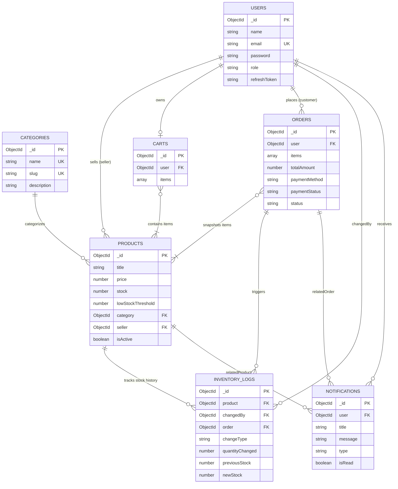

# ShopSphere Backend Documentation

Backend API, Mongoose database architecture, aggregation reports, and real-time notification system for **ShopSphere**.

---

## Database Schema Overview

ShopSphere uses **7 Mongoose collections** in MongoDB (`shopsphere`):

1. **Users** (`users`): Accounts for `customer`, `seller`, and `admin` roles, hashed passwords, and active `refreshToken`.
2. **Categories** (`categories`): Product categories with unique `name` and URL-safe `slug`.
3. **Products** (`products`): Product catalog linked to `Category` and `User` (`seller`), with `stock`, `lowStockThreshold`, and `isActive`.
   - Indexes: `{ seller: 1, stock: 1 }`, `{ category: 1, price: 1 }`.
4. **Carts** (`carts`): One persistent cart document per customer (`user` unique index) containing product references and quantities.
5. **Orders** (`orders`): Customer orders with item price/seller snapshots, shipping address, simulated `paymentMethod` (`card`, `upi`, `cash`), `paymentStatus` (`pending`, `paid`, `failed`, `refunded`), and `status` (`pending`, `confirmed`, `shipped`, `delivered`, `cancelled`).
   - Indexes: `{ user: 1, createdAt: -1 }`, `{ "items.seller": 1, createdAt: -1 }`.
6. **InventoryLogs** (`inventorylogs`): Immutable audit trail for `order_placed`, `order_cancelled`, `restock`, and `manual_adjustment`.
   - Index: `{ product: 1, createdAt: -1 }`.
7. **Notifications** (`notifications`): Per-user notifications (`order`, `low_stock`, `system`) delivered in real time via Socket.IO and persisted for offline viewing.
   - Index: `{ user: 1, isRead: 1, createdAt: -1 }`.

---

## Entity-Relationship Diagram



---

## API Reference

Base URL: `http://localhost:5000`

### Health Check

| Method | Endpoint | Access | Description |
| :--- | :--- | :--- | :--- |
| `GET` | `/api/health` | Public | Returns server status and MongoDB connection state |

### Authentication (`/api/auth`)

| Method | Endpoint | Access | Description |
| :--- | :--- | :--- | :--- |
| `POST` | `/api/auth/register` | Public | Register a `customer` or `seller` account (admin blocked) |
| `POST` | `/api/auth/login` | Public | Authenticate user and issue JWT access + refresh tokens |
| `POST` | `/api/auth/refresh` | Public | Issue a new access token from a valid stored refresh token |
| `POST` | `/api/auth/logout` | Protected | Invalidate stored refresh token |
| `GET` | `/api/auth/me` | Protected | Return current authenticated user profile |

### Categories (`/api/categories`)

| Method | Endpoint | Access | Description |
| :--- | :--- | :--- | :--- |
| `GET` | `/api/categories` | Public | List all categories |
| `GET` | `/api/categories/:id` | Public | Get single category by ID |
| `POST` | `/api/categories` | Admin | Create category |
| `PUT` | `/api/categories/:id` | Admin | Update category |
| `DELETE` | `/api/categories/:id` | Admin | Delete category (blocked if products are linked) |

### Products (`/api/products`)

| Method | Endpoint | Access | Description |
| :--- | :--- | :--- | :--- |
| `GET` | `/api/products` | Public | List active products (`search`, `category`, `minPrice`, `maxPrice`, `inStock`, `sort`, `page`, `limit`) |
| `GET` | `/api/products/:id` | Public | Get single active product details |
| `POST` | `/api/products` | Seller / Admin | Create a new product |
| `PUT` | `/api/products/:id` | Owner Seller / Admin | Update product details |
| `DELETE` | `/api/products/:id` | Owner Seller / Admin | Delete a product |

### Cart (`/api/cart`)

| Method | Endpoint | Access | Description |
| :--- | :--- | :--- | :--- |
| `GET` | `/api/cart` | Customer | Get logged-in customer's cart with backend totals |
| `POST` | `/api/cart` | Customer | Add product (`{ productId, quantity }`) or increment quantity |
| `PUT` | `/api/cart/:productId` | Customer | Set exact quantity (`{ quantity }`) |
| `DELETE` | `/api/cart/:productId` | Customer | Remove one product from cart |
| `DELETE` | `/api/cart` | Customer | Clear entire cart |

### Orders (`/api/orders`)

| Method | Endpoint | Access | Description |
| :--- | :--- | :--- | :--- |
| `POST` | `/api/orders` | Customer | Checkout cart, deduct stock atomically, simulate payment, clear cart |
| `GET` | `/api/orders` | Customer / Seller / Admin | Role-scoped orders list |
| `GET` | `/api/orders/seller` | Seller | Orders containing seller's products (customer PII omitted) |
| `GET` | `/api/orders/admin` | Admin | All store orders |
| `GET` | `/api/orders/:id` | Owner / Involved Seller / Admin | Single order details |
| `PATCH` / `PUT` | `/api/orders/:id/cancel` | Owner Customer / Admin | Cancel `pending`/`confirmed` order and restore stock |
| `PATCH` / `PUT` | `/api/orders/:id/status` | Involved Seller / Admin | Update order status (`confirmed`, `shipped`, `delivered`) |

### Inventory (`/api/inventory`)

| Method | Endpoint | Access | Description |
| :--- | :--- | :--- | :--- |
| `GET` | `/api/inventory` | Seller / Admin | Overview of inventory, low-stock count, and out-of-stock count |
| `GET` | `/api/inventory/low-stock` | Seller / Admin | List products where `stock <= lowStockThreshold` |
| `PUT` / `PATCH` | `/api/inventory/:productId` | Owner Seller / Admin | Set absolute `stock` or apply relative `adjustment`, write `InventoryLog` |
| `GET` | `/api/inventory/logs` | Seller / Admin | Inventory audit logs (scoped to seller products for sellers) |
| `GET` | `/api/inventory/logs/:productId` | Owner Seller / Admin | Audit logs for a specific product |

### Analytics (`/api/analytics`)

| Method | Endpoint | Access | Description |
| :--- | :--- | :--- | :--- |
| `GET` | `/api/analytics/sales` | Seller / Admin | Aggregation of total revenue, order count, and daily breakdown |
| `GET` | `/api/analytics/best-sellers` | Seller / Admin | Top products sorted by units sold and revenue |
| `GET` | `/api/analytics/inventory-summary` | Seller / Admin | Total inventory value, units in stock, and per-category breakdown |

### Notifications (`/api/notifications`)

| Method | Endpoint | Access | Description |
| :--- | :--- | :--- | :--- |
| `GET` | `/api/notifications` | Protected | Fetch latest 50 notifications and unread count |
| `PATCH` / `PUT` | `/api/notifications/read-all` | Protected | Mark all notifications as read |
| `PATCH` / `PUT` | `/api/notifications/:id/read` | Protected (Owner) | Mark a single notification as read |

---

## Real-Time Architecture (EventEmitter + Socket.IO)

- `backend/config/socket.js` authenticates every Socket.IO handshake via the JWT `accessToken` (`socket.handshake.auth.token` or `Authorization` header) and joins the client to room `user:<userId>`.
- `backend/events/appEvents.js` listens to:
  - `order-placed`: Creates order confirmation notification for customer, item order alert for each involved seller (without customer PII), and triggers `stock-low` when needed.
  - `stock-low`: Persists and emits a low-stock alert to the product's seller.
  - `order-cancelled`: Notifies the customer and involved sellers of cancellation and stock restoration.
  - `order-status-updated`: Persists notification and emits `notification` + `order:statusUpdated` to the customer.

---

## Sample Setup Commands

```bash
cd backend
cp .env.example .env
npm install
npm run seed
npm run dev
```

